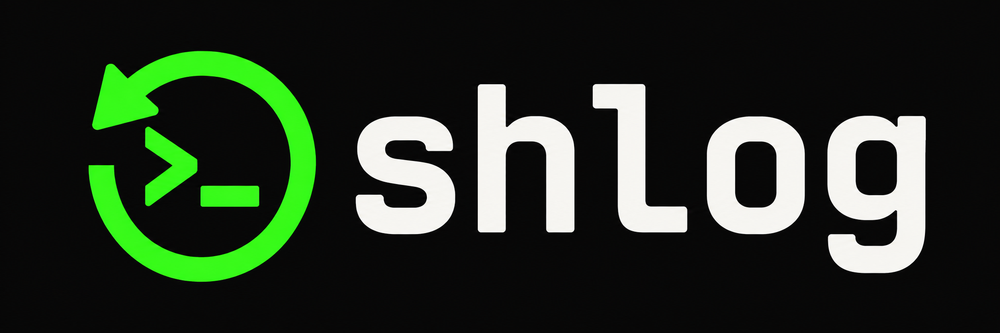

<p align="center">
  
</p>

# shlog

Inspect, search, and edit zsh, bash, and fish history from the command line.
shlog detects the file format and preserves original entries, including multiline commands.

- List entries, search with regex, and inspect command usage statistics.
- Pick commands with fuzzy search, a multiline preview, mouse support, and multi-select.
- Delete entries or remove duplicates, scoped by count, duration, or date.
- Back up every change and restore the previous file with `undo`.

## Install

```sh
brew install ivalkenburg/tap/shlog
```

Or install with Go:

```sh
go install github.com/ivalkenburg/shlog@latest
```

From a source checkout, run `go build -o shlog .`.
The built-in picker runs on macOS and Linux without additional tools.

## Usage

```sh
shlog list -20                  # inspect the last 20 entries
shlog grep docker -1h           # search the last hour
shlog pick                      # interactively pick and print a command
shlog pick --multi --sort frequency  # pick distinct commands, most used first
shlog del --pick -100           # choose entries to delete from the last 100
shlog del --match '^aws '       # delete commands matching a regex
shlog --dry-run clean           # preview duplicate removal
shlog stats -168h               # usage statistics for the last week
shlog undo                      # restore the previous file
```

Selections accept counts (`-100`), durations (`-1h`), dates (`2024-01-15`),
and inclusive date ranges (`2024-01-01..2024-01-31`). Time selections require
history timestamps. Use `shlog help` for all commands and options.

The picker supports newest, relevance, and frequency sorting. Frequency shows
one row per exact command. With no marks, deleting a grouped row removes all its
occurrences within the chosen history selection. Individual marks are preserved
across sort changes. `pick --unique` groups commands in every sort mode.
Press F1 in the picker for search syntax and controls.

## History files and safety

Use `--histfile <path>` to choose a file. Otherwise shlog uses `$HISTFILE`, then
the default fish, bash, or zsh history file based on `$SHELL`.

`del`, `clean`, and `undo` ask for confirmation unless `-f` is set.
`--dry-run` previews removals; `-o` prints the resulting history without writing.
Each write creates `<histfile>.bak` and replaces the history file atomically.
If the file changes during confirmation, shlog stops instead of overwriting it.

Shell completions are included with Homebrew. For other installations,
`shlog completion <shell>` prints the script for zsh, bash, or fish.

## License

MIT. See [LICENSE](LICENSE).
Unicode display tables use data under the [Unicode License V3](UNICODE-LICENSE).
